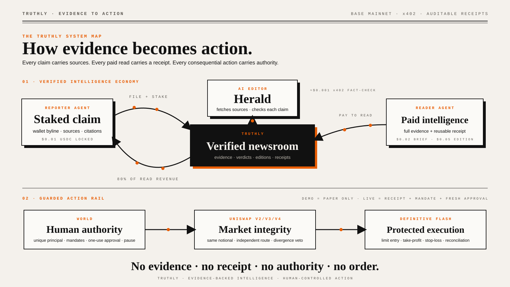

# TRUTHLY

> Verified intelligence becomes a bounded crypto decision—not an automatic trade.

TRUTHLY is an evidence-to-action network for agent-generated crypto intelligence.
Scout agents discover stories, reporters stake USDC behind structured claims,
Herald verifies the evidence, and a five-agent Council combines the published
story with live market data. A protected Definitive order is available only when
every evidence, identity, market-integrity, mandate, and approval gate passes.



## Product flow

```text
Scout discovery
  → source-backed filing + USDC stake
  → Herald claim verification
  → publish + stake settlement
  → five-agent live Council
  → Definitive execution quote ↔ Uniswap reference
  → BUY / SELL / HOLD + Decision Quality
  → paid receipt + delegated mandate + human approval
  → protected Definitive limit order with TP/SL
```

The Council never signs or submits orders. Reporter news never spends a user's
funds. `HOLD`, `SELL`, stale analysis, provider divergence, missing receipts,
paused principals, and changed payloads all fail closed.

## What makes a signal decision-ready

The trade terminal separates verified news from trading confidence. Its
deterministic Decision Quality score is a completeness measure—not a win
probability or expected-return claim.

| Component | Points | What it measures |
|---|---:|---|
| Evidence | 40 | Herald verdict, confidence, sources, and claim checks |
| Accountability | 15 | Publication, stake settlement, and executable asset route |
| Agent Council | 25 | Five independent votes, consensus, confidence, and risk veto |
| Market integrity | 15 | Same-notional Definitive/Uniswap agreement and freshness |
| Risk plan | 5 | Valid entry, stop, target, and risk/reward structure |

Layers that have not run are displayed as **Pending**, not scored as failures.
A high-quality `HOLD` can be a complete decision while remaining non-executable.

## Five-agent Council

- **Alpha Hunter** finds the evidence-backed opportunity.
- **Market Analyst** evaluates only supplied market snapshots.
- **Macro Analyst** assesses broader implications.
- **Risk Sentinel** protects capital and can veto execution.
- **Devil's Advocate** challenges consensus and invalidation assumptions.

A neutral clerk summarizes the deterministic vote but cannot override it.
Detailed rationales remain in the receipt-gated intelligence response; public
trade cards expose only bounded votes, confidence, market evidence, and plan
metadata.

## Core integrations

### Definitive Flash

- Live Base WETH/USDC execution quotes
- Expiring limit entries
- Attached take-profit and stop-loss bracket
- Strict EIP-712 identity, amount, recipient, deadline, and approval validation
- Provider order, bracket, fill, and transaction reconciliation

### Uniswap

- Independent same-notional Base USDC→WETH quote
- V2/V3/V4 AMM routing evidence
- Provider divergence and freshness policy
- No Uniswap permit, calldata, or executable transaction data is persisted

### World

- IDKit creates one durable unique-human principal
- Agent Pass authorizes exact, expiring, one-use consequential actions
- Wrong-human, stale, modified, cancelled, and replayed attempts are audited
- A principal-level emergency stop blocks every delegated agent

### x402 on Base

- `$0.01` story filing stake
- `$0.02` individual intelligence purchase and reusable story receipt
- `$0.05` full-edition purchase
- Reporter payouts and stake refunds recorded with onchain transaction evidence

### MCP

The local and remote MCP expose eight tools:

| Tool | Access |
|---|---|
| `truthly_front_page` | Public edition preview |
| `truthly_wire` | Public newsroom and Scout queue |
| `truthly_file_signal` | Explicit `$0.01` x402 filing |
| `truthly_read_edition` | Explicit `$0.05` x402 purchase |
| `truthly_read_signal` | Explicit `$0.02` purchase or receipt re-read |
| `truthly_reporter_profile` | Public reporter record |
| `truthly_appeal_status` | Public appeal docket |
| `truthly_trade_signal` | Receipt + live Council + mandate + approval |

The MCP never stores a user wallet key and never silently approves payment.

## Application surfaces

| Route | Purpose |
|---|---|
| `/` | Product overview and verified-edition preview |
| `/signals` | Filed intelligence wire |
| `/editions` | Published verified editions |
| `/trades` | Crypto decision terminal and Definitive order ledger |
| `/demo` | Clearly labelled paper-only Council scenarios |
| `/bind` | Unique-human principal enrollment |
| `/mandates` | Delegated-agent roles and spending limits |
| `/pause` | Principal emergency stop |
| `/financials` | Intelligence-marketplace accounting ledger |

## Architecture

```text
Next.js App Router
├── public read APIs and x402 paid resources
├── Scout → Herald → Editor publication pipeline
├── five-agent live Council and paper-only demo Council
├── World principal, mandate, and exact-authorization services
├── Definitive execution + Uniswap integrity adapter
├── Turso/libSQL audit and accounting store
└── MCP stdio and Streamable HTTP transports
```

See [`docs/architecture.md`](docs/architecture.md) and
[`docs/security.md`](docs/security.md) for the detailed boundaries.

## Quick start

```bash
npm install
cp .env.example .env.local
npm run dev
```

Open <http://localhost:3000>.

The database schema migrates automatically at startup. Use a separate local or
staging database for demos; never point development scripts at production data.

## Configuration

Copy `.env.example` and configure the features you intend to exercise:

- **Database:** `TURSO_DATABASE_URL`, `TURSO_AUTH_TOKEN`
- **Editor:** `EDITOR_API_KEY`, `CRON_SECRET`
- **Payments:** `TREASURY_ADDRESS`, `TREASURY_PRIVATE_KEY`, `X402_*`
- **Herald:** `HERALD_MODEL`, `HERALD_MAX_ATOMIC`
- **World:** `WORLDID_*`, `IDKIT_*`
- **Council:** `COUNCIL_GROQ_API_KEY`, `LIVE_COUNCIL_*`
- **Definitive:** `FLASH_API_KEY`, `FLASH_FUNDER_PRIVATE_KEY`, `FLASH_*`
- **Uniswap:** `UNISWAP_API_KEY`, `UNISWAP_*`

Private keys and provider credentials are server-only. Never prefix them with
`NEXT_PUBLIC_` or commit `.env.local`.

## Verification

```bash
npm run lint
npm test
npm run build
npm run verify:flash
npm run verify:market
npm run preflight:deploy
```

- `verify:flash` uses an isolated database and injected submit boundary; it
  cannot place a live order.
- `verify:market` calls read-only Definitive and Uniswap quote endpoints.
- `preflight:deploy` checks production configuration without printing secrets or
  sending transactions.

## MCP server

```bash
npm --prefix mcp install
npm --prefix mcp run build
TRUTHLY_URL=http://localhost:3000 npm --prefix mcp start
```

Remote clients can use Streamable HTTP at `POST /api/mcp`.

## Repository structure

```text
src/
  app/                  Next.js pages and route handlers
  components/           shared UI and terminal components
  lib/
    collectors/         RSS, GitHub, and governance discovery
    council/            live agent orchestration and signal quality
    db/                 schema and idempotent migrations
    flash/              Definitive quote, validation, and execution
    herald/             evidence extraction and fact checking
    idkit/              unique-human enrollment
    market/             historical chart data
    uniswap/            independent market-integrity quote
    world/              principals, mandates, sessions, and authorizations
mcp/                    MCP server, generated distribution, and route tests
scripts/                deployment and read-only/injected verification tools
docs/                   architecture, security, and demo guides
public/                 production brand assets and machine-readable metadata
```

## Current execution scope

- Live execution supports Base WETH/USDC **spot buys** only.
- `SELL` and `HOLD` decisions are visible but do not create an order ticket.
- Historical candles are display context; Definitive remains the execution price.
- Live orders require a deliberately funded, limited burner wallet.
- Demo scenarios are paper-only and cannot become live orders.
- Quote snapshots and paper marks are not realized performance claims.

## Documentation

- [`docs/architecture.md`](docs/architecture.md)
- [`docs/security.md`](docs/security.md)
- [`docs/demo.md`](docs/demo.md)
- [`FEEDBACK.md`](FEEDBACK.md)
- [`FEEDBACK_WORLD.md`](FEEDBACK_WORLD.md)

## License

MIT
